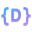

# DapCode TextMate Grammar & Syntax Definition ⚡

Official TextMate syntax highlighting grammar for the **[DapCode](https://github.com/codedaffa/dapcode-lang)** programming language (`.dap`). Designed for use in **VS Code**, **GitHub Linguist**, **VSCodium**, **Antigravity IDE**, and any editor supporting the TextMate grammar specification.

<p align="center">
  
  <br/>
  <strong>DapCode — Modern Sovereign Systems Programming Language</strong>
</p>

---

## 📋 Grammar Specifications

| Property | Value |
| :--- | :--- |
| **Language Name** | `DapCode` |
| **Scope Name** | `source.dap` |
| **File Extension** | `.dap` |
| **Grammar Format** | TextMate JSON (`syntaxes/dapcode.tmLanguage.json`) |
| **License** | [MIT](LICENSE) |
| **Upstream Compiler** | [codedaffa/dapcode-lang](https://github.com/codedaffa/dapcode-lang) |

---

## ✨ Highlighted Syntax Elements

This grammar provides precise semantic classification for:
- **Keywords & Declarations**: `fungsi`, `struktur`, `sifat`, `terapkan`, `untuk`, `impor`, `comptime`, `uji`
- **Control Flow**: `jika`, `selain_itu`, `selama`, `untuk`, `di`, `kembali`
- **Error Handling**: Error union operators (`!`, `?`), `gagal`, `tangkap`
- **Colorless Concurrency**: `jalan_paralel`, `tunggu`
- **Primitives & Types**: `u64`, `i64`, `f64`, `Teks`, `Bool`, `Daftar`, `Kamus`, `BasisData`, `Waktu`
- **String Interpolation**: Full recursive interpolation highlight within `"{variabel}"`
- **Walrus Operator**: Variable declaration `:=` and Hindley-Milner type inference
- **Built-in Functions & Methods**: Extensive standard library keywords (`cetak`, `baca_berkas`, `sha256`, `kanvas_*`, etc.)
- **Comments**: Single-line (`//`), doc comments (`///`, `//!`), and block comments (`/* */`)

---

## 🛠️ GitHub Linguist Integration

To vendor this grammar into [github-linguist/linguist](https://github.com/github-linguist/linguist):

```bash
# Inside your local clone of github-linguist/linguist
script/add-grammar https://github.com/codedaffa/dapcode-grammar
```

And in `lib/linguist/languages.yml`:

```yaml
DapCode:
  type: programming
  color: "#38bdf8"
  extensions:
    - ".dap"
  tm_scope: source.dap
  ace_mode: text
  codemirror_mode: clike
```

---

## 📄 License

Distributed under the [MIT License](LICENSE). Copyright (c) 2026 Muhammad Daffa Al Farizi / DapCode Core Team.
